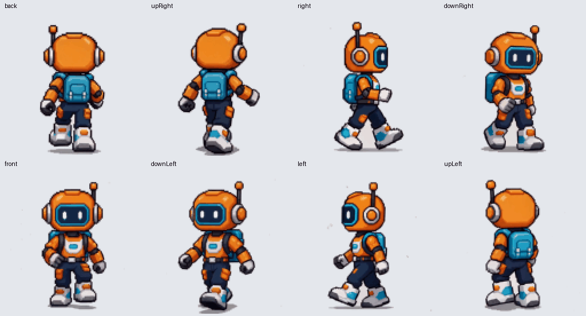
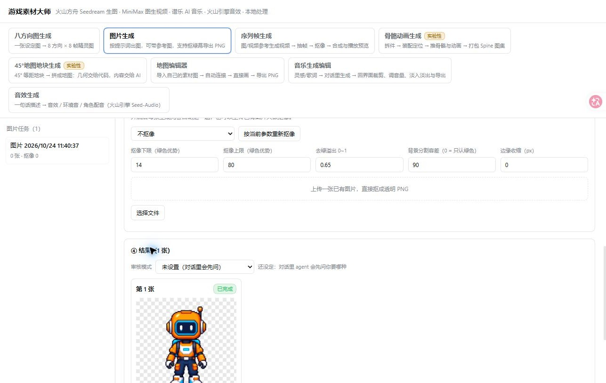
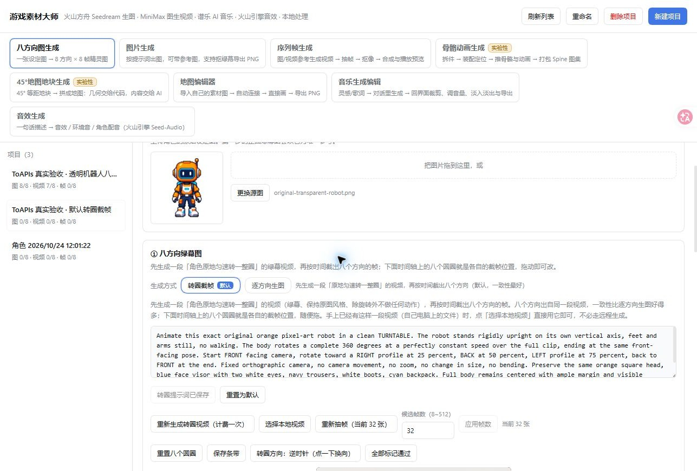
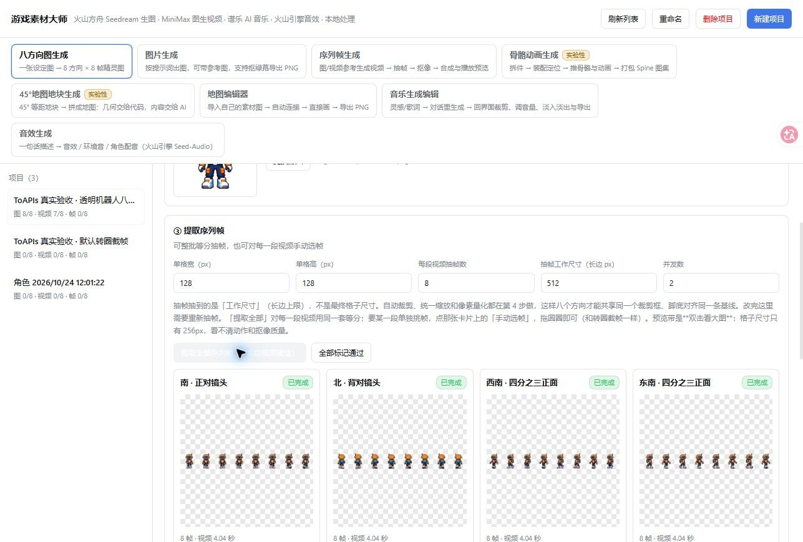
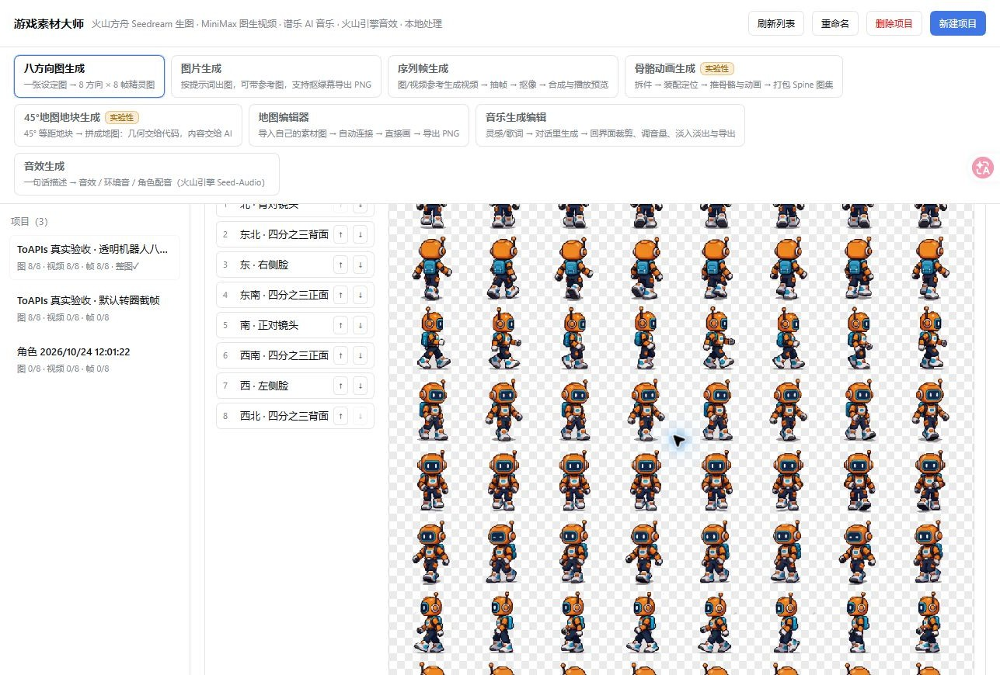
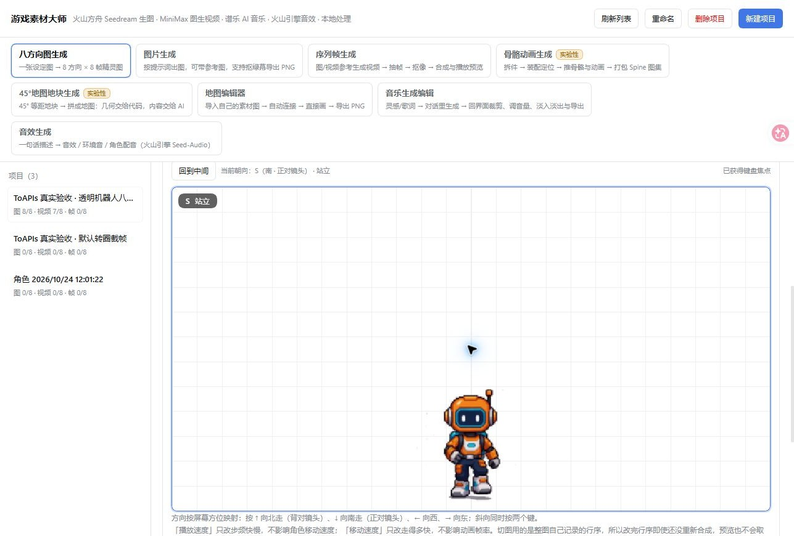

# Real DSH acceptance — 2026-10-24 / 真实验收

The optional Provider was merged in upstream PR #7. This follow-up contains fixes found during real Windows DSH 0.2.1-rc.2 acceptance and a reusable configuration guide. Paid generations were triggered in the actual DSH Web UI; project fixtures were prepared through the actual plugin service. The source setup/name dialog itself was not part of UI acceptance.

## Verified output

| Path | Result |
|---|---|
| Image generation | Actual `gpt-image-2-vip` transparent source PNG, downloaded through UI |
| Eight directions | Eight native-alpha views, visually checked front/back/side/diagonal |
| Walking videos | Eight 640×640 MP4 clips, each 97 frames / 4.041667s; full-body composition and different sampled motion frames checked |
| Extraction and export | Eight groups × eight frames, final 1024×1024 RGBA PNG, 64 nonempty distinct-per-row cells; actual UI download byte-identical to host output |
| Optional default turntable | One actual clip → 32 candidate frames → eight direction crops; no second set of walking videos bought |
| Preview | DSH stage⑤ loaded the exported sheet. Automated short key taps did not establish sustained keyboard movement; full interactive keyboard play remains a manual check. The GIF below is derived from real exported frames, not a screen recording. |

[Download original sprite PNG](ToAPIs-robot-8dir-8frames.png) · [Machine checks](最终精灵导出检查.json) · [Video checks](真实视频检查.json) · [Billing summary](billing-summary.json) · [Configuration, prices and reuse](../TOAPIS.md).

## Fixes found in real use

- Save the latest image drafts before generation and serialize pending blur saves: immediate typing → clicking Generate no longer races an empty stored prompt.
- Expose GPT Image `background=transparent`; preserve source PNG alpha, and explicitly matte transparent video first frames on white for opaque MP4 output.
- Expose video aspect ratio: the initial 16:9 robot trial cropped head/feet, so the reviewed 1:1 output replaces it. The initial trial and its cost remain in billing.
- Reuse bounded atomic JSON write retries for Windows project saves. A real Windows file lock reproduced the issue and passed after the fix. Start polling each accepted batch video immediately so another direction's local failure does not strand submitted paid tasks.
- A completed image's transient download failure was recovered from its existing task ID without another paid image POST. After restart, six submitted videos were recovered without paid resubmission.

## Scope and quality

This is a reproducible sample, not a guarantee of identical generations or production-ready seamless cycles. The robot is visually consistent across directions, while generated video can vary visor expressions, shadows and gait timing. The turntable's angular speed is not perfectly uniform; review/adjust candidate picks before approving. White-background segmentation can affect white details and compression edges, so inspect at final scale. Source PNG alpha and video-derived background removal are different paths.

Music, sound effects, experimental rig and map generation did not receive new paid ToAPIs acceptance; their existing providers remain separate. Local automated checks are reported separately from real UI evidence. No keys, private config, account screenshots, signed result URLs, or auth headers are included.

## Costs

China site only, same test key: 10 videos **$0.704402 settled**, 9 image tasks **settlement pending** (quote only **$0.0019/image**, total **$0.0171**). Video quote **$1.88806/M total tokens** at the tested conditions; the square clip's actual **$0.070116 / 4.041667s ≈ $0.01735/s** is a sample average, not a fixed seconds tariff. See the configuration guide for complete conditions. No Seedance Global was used.

## Candidate compatibility checks

Rebased by three-way merge onto upstream `22f5ed4` after PR #7 was merged. TypeScript build passed; **22/25 local suites passed** (ToAPIs **43** assertions, feedback **217**). Three incomplete/failing suites are documented in [local-regressions.json](local-regressions.json): Windows fake-Python detection, absent `unzip` utility, and the existing map-client `penNode` harness error. The additional actual ffmpeg/PNG ZIP regression and real Win32 file-lock recovery both passed. These checks do not claim a second paid UI run on the newer map-editor revision. UI screenshots show the tested earlier workbench; current upstream retains its new 45° editor.
